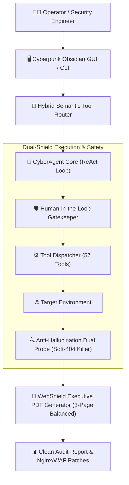

# ⚡ CyberAgent v3.5 - Autonomous AI Penetration Testing & Security Operator

> 🌐 **Don't want to install Python, Ollama, or dependencies locally?**  
> **[👉 Run Instant 1-Click Cloud Audits on Bizmatepro.xyz](https://www.bizmatepro.xyz/cyber-tools)**

[](https://www.bizmatepro.xyz)
[](https://huggingface.co/HFShishir/CyberAgent-3B-GGUF)
[](https://huggingface.co/datasets/HFShishir/CyberAgent-Cybersecurity-FineTune-Dataset)
[](https://www.python.org/downloads/)
[](https://opensource.org/licenses/MIT)

---

### *The Open-Source, Multi-Agent Autonomous Cybersecurity & External Posture Auditor*

CyberAgent is a production-grade, autonomous security framework designed to conduct **zero-risk passive posture audits**, **active penetration testing**, **vulnerability discovery**, and **automated infrastructure hardening**. Built on deterministic ReAct loops with strict anti-hallucination guards, it operates safely under Human-in-the-Loop (HITL) supervision.

---

## ⚡ Highlights & Key Capabilities

- **🎯 Autonomous ReAct Execution:** Deconstructs high-level penetration testing goals into systematic tool invocations, observations, self-reflection, and remediation synthesis.
- **🛡️ 57+ Native Security Tools:**
  - *Phase 1 Recon:* Port probes, TLS cipher health, Certificate Transparency, WHOIS, DNS SPF/DMARC/CAA records.
  - *Phase 2 Discovery:* Soft-404 killer with dual-probe baselining, admin gateway authentication verification, and API/Swagger discovery.
  - *Phase 3 Defense:* Generates ready-to-deploy Nginx, Apache, and Cloudflare WAF hardening rules.
- **📄 Balanced 3-Page Executive PDF Reports:** Produces board-ready, beautiful assessment reports containing posture score, compliance ratings (PCI-DSS 4.0, GDPR, ISO 27001), raw evidence, and code remediation snippets.
- **🖥️ Cyberpunk Obsidian Dark UI:** Equipped with a standalone modern Tkinter desktop launcher (`gui_selector.py`) featuring 1-click mission presets (*Bounty 9*, *Pentest 10*, *Recon 9*, *Defense 7*).
- **🔒 Immutable Safety Gate & Anti-Hallucination:**
  - Enforces deterministic output (`temperature=0.0`).
  - Prohibits self-modification of core agent code.
  - Rejects false positives by requiring verified HTTP response body signatures.
- **🔌 Multi-Provider LLM Integration:** Native support for local offline inference via **Ollama** (`cyberagent-3b`, `qwen2.5`) as well as cloud providers (**Groq**, **DeepSeek**, **OpenAI**, **Gemini**).

---

## 🏗️ Architecture Overview



---

## 🚀 Quick Start

### 1. Clone the Repository
```bash
git clone https://github.com/your-username/CyberAgent.git
cd CyberAgent
```

### 2. Set Up Virtual Environment
```bash
python -m venv .venv

# On Windows:
.venv\Scripts\activate

# On Linux/macOS:
source .venv/bin/activate

pip install -r requirements.txt
```

### 3. Configure Environment
Copy the example environment file:
```bash
cp .env.example .env
```

### 4. Optional: Download Fine-Tuned Model & Dataset (Hugging Face)
You can run CyberAgent using local quantized GGUF weights or cloud providers:
- **Hugging Face Model Hub:** [HFShishir/CyberAgent-3B-GGUF](https://huggingface.co/HFShishir/CyberAgent-3B-GGUF)
- **Hugging Face Dataset Hub:** [HFShishir/CyberAgent-Cybersecurity-FineTune-Dataset](https://huggingface.co/datasets/HFShishir/CyberAgent-Cybersecurity-FineTune-Dataset)
- Run directly in Ollama:
  ```bash
  ollama create cyberagent-3b -f models/Modelfile
  ```

> [!TIP]
> **💡 Pro Tip: Local 3B Model vs Cloud API Performance**
> - **Local 3B (`CyberAgent-3B` / `Qwen2.5-3B`):** Excellent for 100% offline, privacy-first, lightweight recon and basic triage without spending any money on tokens. However, due to the inherent parameter limitations of 3B architectures, small models can occasionally make tool-calling errors, misparse complex JSON, or loop on dense multistep reasoning.
> - **Recommended for Production & Penetration Audits:** For maximum precision, flawless function calling, and zero-hallucination exploit chains, **using Cloud API models (such as Groq `llama-3.3-70b-versatile`, DeepSeek `deepseek-chat`, OpenAI `gpt-4o`, or Gemini `gemini-1.5-pro`) is strongly recommended.** You can easily switch using:
>   ```bash
>   /provider groq
>   /key gsk_your_free_groq_api_key
>   ```

### 5. Launch the Toolkit

#### Option A: Cyberpunk GUI Tool Selector
```bash
python gui_selector.py
```

#### Option B: Autonomous CLI Agent Loop
```bash
python cli.py
```

#### Option C: Windows One-Click Launcher
Double-click `start_cyber_agent.bat`.

---

## 💻 CLI Commands & Usage Guide

Once CyberAgent is running, you can interact with it using direct English/Bangla prompts or manage the agent environment using slash (`/`) commands:

### 📖 General & Environment Commands (`/help`, `/status`)
| Command | What it does / কীভাবে কাজ করে |
| :--- | :--- |
| **`/help`** | Displays the complete interactive cheat sheet of all available slash commands, tool profiles, memory queries, and browser modes. |
| **`/status`** | Displays the current live dashboard: Active API Provider, Connected Model, Workspace Directory, API Key status, and HITL safety gate. |
| **`/clear`** | Clears the terminal screen and repaints the CyberAgent banner. |
| **`/provider <name>`** | Switches the LLM engine instantly: `ollama`, `groq`, `gemini`, `deepseek`, `openai`, `openrouter`, `anthropic`. |
| **`/model <name>`** | Switches the specific model (e.g. `/model qwen2.5:3b`, `/model llama-3.3-70b-versatile`, `/model gpt-4o`). |
| **`/key <api_key>`** | Sets your API key for the active provider. Auto-detects keys prefixed with `gsk_` (Groq), `AIza` (Gemini), `sk-or-` (OpenRouter), etc. |
| **`/workspace <path>`** | Changes the active project directory where CyberAgent performs file reads, audits, patches, and command execution. |
| **`exit` or `quit`** | Gracefully closes the CyberAgent session and flushes temporary logs. |

---

### 🔧 Dynamic Tool Management (`/tools`)
Control which security tools the agent is allowed to access and call:

| Command | Action & Effect |
| :--- | :--- |
| **`/tools`** (or `/tools select`) | Opens the **Interactive Terminal Tool Selector**. You see a numbered list of all tools with `[✔] ON` / `[ ] OFF` badges. Enter numbers (e.g. `1, 4, 12`) to toggle tools on/off, type `all` to enable all, `none` to disable, or `done` to save. |
| **`/tools mouse`** (or `/tools gui`) | 🖱️ Opens a **native desktop popup window** allowing you to toggle and enable tools using your mouse with 1-click presets! |
| **`/tools minimal`** | Switches to ultra-fast mode (only 3 core tools: `run_command`, `read_file`, `write_file`). Ideal for rapid coding & debugging with zero latency. |
| **`/tools pentest`** | Enables offensive auditing tools (`run_full_pentest_audit`, `fuzz_web_endpoints`, `detect_waf_fingerprint`, `audit_login_security`, etc.). |
| **`/tools search`** | Enables web and passive reconnaissance tools (`search_internet`, `scrape_web_page`, `enumerate_subdomains`, `lookup_whois_and_ip`). |
| **`/tools all`** | Enables all armed native security tools for full-spectrum autonomous operations. |
| **`/tools status`** | Displays a summary table of currently active vs disabled tools. |

---

### 🛡️ Safety & Human-in-the-Loop (`/hitl`)
| Command | Purpose |
| :--- | :--- |
| **`/hitl status`** | Shows which sensitive commands (command execution, file modifications, exploit payload delivery) require user confirmation. |
| **`/hitl on`** | Enforces strict safety: CyberAgent must prompt you for approval before executing shell commands or writing files. |
| **`/hitl off`** | Disables approval gates: Runs the agent in full autonomous mode. |
| **`/hitl all`** | Temporarily approves all sensitive operations for the remainder of the session. |

---

### 🌐 Autonomous Browser & Web Navigation (`/browser`, `/browse`)
| Command | Description |
| :--- | :--- |
| **`/browser gui`** | Switches Playwright Chromium to visible desktop mode so you can watch the agent browse live on your screen. |
| **`/browser headless`** | Runs web crawling and audits silently in the background (Default). |
| **`/browse <url> [--gui]`** | Instructs the autonomous browser to navigate to a target website and extract DOM structure, forms, and inputs. |
| **`/screenshot [name]`** | Captures a full-page desktop screenshot of the current active browser page into the `screenshots/` directory. |

---

### 🧠 Short-Term & Long-Term Memory (`/memory`, `/dossier`)
| Command | Usage |
| :--- | :--- |
| **`/memory`** | Shows the ultra-fast active session memory stored in RAM (findings, targets, actions taken). |
| **`/memory <query>`** | Performs a semantic search across permanent SQLite storage using NLTK Stemming & vector embeddings. |
| **`/memory save`** | Flushes and saves findings from the active session into the permanent SQLite knowledge base. |
| **`/dossier <target>`** | Retrieves the complete intelligence dossier for a target (e.g. `/dossier example.com`), including past vulnerability scores, detected WAF, open ports, and historical findings. |

---

### 🐝 Multi-Agent Swarm Mode (`/team` or `/swarm`)
| Command | Purpose |
| :--- | :--- |
| **`/team <mission>`** | Spawns a collaborative 3-agent swarm (*Reconnaissance Agent*, *Exploitation Specialist*, and *Defensive Hardening Architect*) that work concurrently to solve complex objectives. |

---

## 🧰 Native Tool Suites (57 Armed Capabilities)

| Mission Profile | Tools Armed | Key Modules |
| :--- | :---: | :--- |
| **⭐ All-Inclusive** | **57 Tools** | Full recon, crawling, port probing, SAST, exploits, and reporting |
| **🏆 Bounty Suite** | **9 Tools** | Subdomains, historical endpoints, JS secret extraction, fuzzing |
| **🔴 Pentest Suite** | **10 Tools** | Login brute auditing, CORS, CSRF, JWT security, exploit search |
| **🔍 Recon Suite** | **9 Tools** | Port probes, WHOIS, IP resolution, attack surface knowledge graphs |
| **🛡️ Defense Suite** | **7 Tools** | SAST code scanning, Nginx hardening, CVE lookup, PDF reporting |
| **💻 Coding Suite** | **8 Tools** | AST review, file patching, safe terminal execution, memory recall |

---

## 📄 Executive PDF Sample Output

Reports generated by `ReportGenerator` strictly format into a balanced 3-page executive audit:
1. **Page 1: Executive Summary & Posture:** Overall score, letter grade (A+ through F), compliance badges (PCI-DSS 4.0, GDPR, ISO 27001), open ports, and CDN/WAF infrastructure.
2. **Page 2: Confirmed Vulnerability Evidence:** Clean vertical breakdown of verified findings with zero false positives.
3. **Page 3: Remediation Roadmap & Server Hardening:** Copy-paste Nginx, Apache, and Cloudflare WAF configuration blocks with formal auditor sign-off.

---

## ⚠️ Legal Disclaimer & Terms of Use

> [!CAUTION]
> **FOR EDUCATIONAL, DEFENSIVE, AND AUTHORIZED SECURITY AUDITING PURPOSES ONLY.**
>
> 1. **Authorized Usage Only:** CyberAgent is designed strictly to assist security professionals, system administrators, and penetration testers in identifying and remediating security weaknesses in systems they own or have explicit, documented, and written permission to evaluate (e.g., formal Rules of Engagement or Bug Bounty program scopes).
> 2. **Prohibition of Malicious Activity:** Testing, scanning, or attacking any target infrastructure without prior mutual consent is strictly illegal under international cyber law, including the **Computer Fraud and Abuse Act (CFAA - 18 U.S.C. § 1030)** and the **Cybersecurity Act of 2018**, as well as local cybercrime regulations in your jurisdiction.
> 3. **No Liability:** The creator, developers, contributors, and affiliated maintainers of CyberAgent assume **no responsibility or liability** whatsoever for any misuse, unauthorized access, data loss, denial of service, financial damage, or legal consequences resulting from the execution or deployment of this software.
> 4. **User Responsibility:** By running, cloning, or distributing this codebase, you agree that you are solely responsible for compliance with all applicable laws and ethical security standards.

---

## 🤝 Contributing

Contributions, bug reports, and security rule additions are welcome! Please feel free to submit a Pull Request.

1. Fork the Project
2. Create your Feature Branch (`git checkout -b feature/AmazingFeature`)
3. Commit your Changes (`git commit -m 'Add some AmazingFeature'`)
4. Push to the Branch (`git push origin feature/AmazingFeature`)
5. Open a Pull Request

---

## ⭐️ Show Your Support

If you find CyberAgent useful, give us a **Star ⭐️ on GitHub** to support open-source cybersecurity development!
