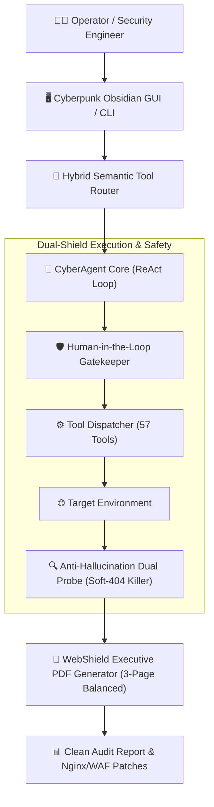

<div align="center">

# 🛡️ CyberAgent (Autonomous Penetration Testing & AI Security Engine)

**The Open-Source, Multi-Agent Autonomous Cybersecurity & External Posture Auditor**

[](https://www.python.org/downloads/)
[](https://opensource.org/licenses/MIT)
[]()
[]()
[](http://makeapullrequest.com)

---

### *Transforming Reactive Security Scans into Autonomous AI-Driven Defense*

</div>

CyberAgent is a production-grade, autonomous security framework designed to conduct **zero-risk passive posture audits**, **active penetration testing**, **vulnerability discovery**, and **automated infrastructure hardening**. Built on deterministic ReAct loops with strict anti-hallucination guards, it operates safely under Human-in-the-Loop (HITL) supervision.

---

## ⚡ Highlights & Key Capabilities

- **🎯 Autonomous ReAct Execution:** Deconstructs high-level penetration testing goals into systematic tool invocations, observations, self-reflection, and remediation synthesis.
- **🛡️ 57+ Native Security Tools:**
  - *Phase 1 Recon:* Port probes, TLS cipher health, Certificate Transparency, WHOIS, DNS SPF/DMARC/CAA records.
  - *Phase 2 Discovery:* Soft-404 killer with dual-probe baselining, admin gateway authentication verification, and API/Swagger discovery.
  - *Phase 3 Defense:* Generates ready-to-deploy Nginx, Apache, and Cloudflare WAF hardening rules.
- **📄 Balanced 3-Page Executive PDF Reports:** Produces board-ready, beautiful assessment reports containing posture score, compliance ratings (PCI-DSS 4.0, GDPR, ISO 27001), raw evidence, and code remediation snippets.
- **🖥️ Cyberpunk Obsidian Dark UI:** Equipped with a standalone modern Tkinter desktop launcher (`gui_selector.py`) featuring 1-click mission presets (*Bounty 9*, *Pentest 10*, *Recon 9*, *Defense 7*).
- **🔒 Immutable Safety Gate & Anti-Hallucination:**
  - Enforces deterministic output (`temperature=0.0`).
  - Prohibits self-modification of core agent code.
  - Rejects false positives by requiring verified HTTP response body signatures.
- **🔌 Multi-Provider LLM Integration:** Native support for local offline inference via **Ollama** (`cyberagent-3b`, `qwen2.5`) as well as cloud providers (**Groq**, **DeepSeek**, **OpenAI**, **Gemini**).

---

## 🏗️ Architecture Overview



---

## 🚀 Quick Start

### 1. Clone the Repository
```bash
git clone https://github.com/your-username/CyberAgent.git
cd CyberAgent
```

### 2. Set Up Virtual Environment
```bash
python -m venv .venv

# On Windows:
.venv\Scripts\activate

# On Linux/macOS:
source .venv/bin/activate

pip install -r requirements.txt
```

### 3. Configure Environment
Copy the example environment file:
```bash
cp .env.example .env
```

### 4. Optional: Download Fine-Tuned Local Model (Hugging Face)
You can run CyberAgent using local quantized GGUF weights or cloud providers:
- **Hugging Face Model Hub:** [HFShishir/CyberAgent-3B-GGUF](https://huggingface.co/HFShishir/CyberAgent-3B-GGUF)
- Run directly in Ollama:
  ```bash
  ollama create cyberagent-3b -f models/Modelfile
  ```

### 5. Launch the Toolkit

#### Option A: Cyberpunk GUI Tool Selector
```bash
python gui_selector.py
```

#### Option B: Autonomous CLI Agent Loop
```bash
python cli.py
```

#### Option C: Windows One-Click Launcher
Double-click `start_cyber_agent.bat`.

---

## 🧰 Native Tool Suites (57 Armed Capabilities)

| Mission Profile | Tools Armed | Key Modules |
| :--- | :---: | :--- |
| **⭐ All-Inclusive** | **57 Tools** | Full recon, crawling, port probing, SAST, exploits, and reporting |
| **🏆 Bounty Suite** | **9 Tools** | Subdomains, historical endpoints, JS secret extraction, fuzzing |
| **🔴 Pentest Suite** | **10 Tools** | Login brute auditing, CORS, CSRF, JWT security, exploit search |
| **🔍 Recon Suite** | **9 Tools** | Port probes, WHOIS, IP resolution, attack surface knowledge graphs |
| **🛡️ Defense Suite** | **7 Tools** | SAST code scanning, Nginx hardening, CVE lookup, PDF reporting |
| **💻 Coding Suite** | **8 Tools** | AST review, file patching, safe terminal execution, memory recall |

---

## 📄 Executive PDF Sample Output

Reports generated by `ReportGenerator` strictly format into a balanced 3-page executive audit:
1. **Page 1: Executive Summary & Posture:** Overall score, letter grade (A+ through F), compliance badges (PCI-DSS 4.0, GDPR, ISO 27001), open ports, and CDN/WAF infrastructure.
2. **Page 2: Confirmed Vulnerability Evidence:** Clean vertical breakdown of verified findings with zero false positives.
3. **Page 3: Remediation Roadmap & Server Hardening:** Copy-paste Nginx, Apache, and Cloudflare WAF configuration blocks with formal auditor sign-off.

---

## 🛡️ Responsible Disclosure & Legal Disclaimer

> **⚠️ IMPORTANT:** CyberAgent is intended strictly for educational, defensive, and authorized security auditing purposes. Do not scan or assess targets without explicit written authorization (Rules of Engagement). The authors and contributors assume no liability for misuse or damage caused by this software.

---

## 🤝 Contributing

Contributions, bug reports, and security rule additions are welcome! Please feel free to submit a Pull Request.

1. Fork the Project
2. Create your Feature Branch (`git checkout -b feature/AmazingFeature`)
3. Commit your Changes (`git commit -m 'Add some AmazingFeature'`)
4. Push to the Branch (`git push origin feature/AmazingFeature`)
5. Open a Pull Request

---

## ⭐️ Show Your Support

If you find CyberAgent useful, give us a **Star ⭐️ on GitHub** to support open-source cybersecurity development!
